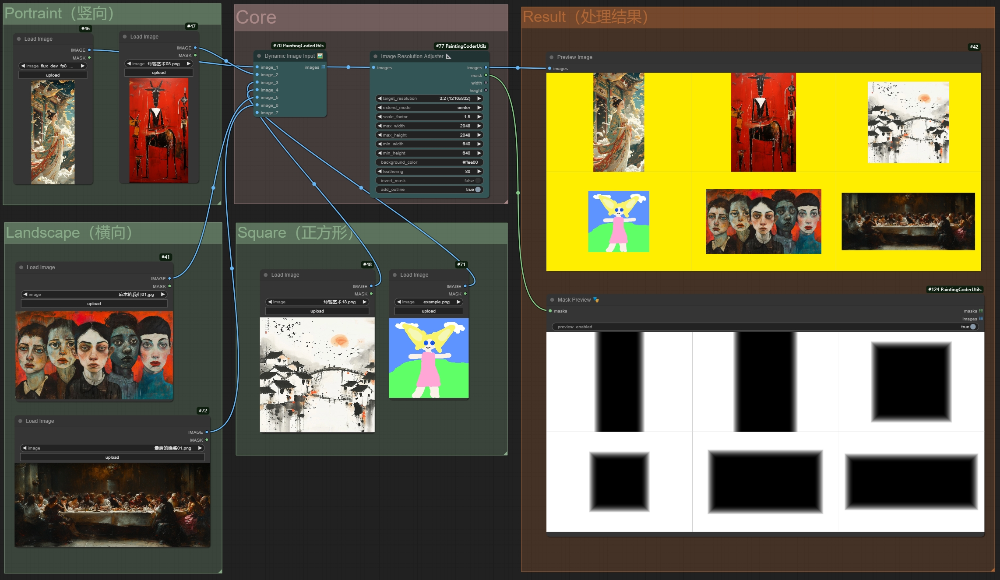

# ComfyUI Painting Coder Utilities


画像サイズ調整、テキスト整形、マスク処理とワークフロー修復のための ComfyUI カスタムノード集です。目的から入口を選び、詳しい設定は既存のノード資料を参照してください。

[English](README.md) | [简体中文](README_CN.md) | [繁體中文（臺灣）](README.zh-TW.md) | [日本語](README.ja.md) | [한국어](README.ko.md)

## 目的から選ぶ

| 目的 | 既存の入口 |
| --- | --- |
| 画像の解像度を調整 | `ImageResolutionAdjuster` |
| 画像・latent のサイズを作成 | `ImageSizeCreator`、`ImageLatentCreator` と Plus 版 |
| 画像・マスクを結合／確認 | `DynamicImageCombiner`、`DynamicMaskCombiner`、`MaskPreview` |
| テキストの整形・結合・表示 | `RemoveEmptyLinesAndLeadingSpaces`、`TextCombiner`、`ShowTextPlus` |
| ワークフローの値を切替 | 画像・テキスト・マスク・latent の切替ノード |
| URL画像の読込／エンコード | `WebImageLoader`、`ImageToBase64` |



既存プロジェクトのワークフロー画像です。AI生成の製品イメージではありません。

## ComfyUI 環境への導入

ComfyUI を実行している Python を使ってください。互換性のない Torch を追加しないよう注意してください。requirements.txt には NumPy、Pillow、Torch、Gradio が記載されています。環境との互換性を確認してから依存関係を導入し、クローン後に ComfyUI を再起動します。

```sh
cd ComfyUI/custom_nodes
git clone https://github.com/jammyfu/ComfyUI_PaintingCoderUtils.git
# Run with the Python interpreter used by ComfyUI:
python -m pip install -r ComfyUI_PaintingCoderUtils/requirements.txt
```

## 旧ワークフローの移行と最初の例

v0.3.0 の名前空間変更により、古いワークフローが動かない場合があります。まず JSON をバックアップし、ローカルのブラウザ修復ツールでノード名とパス区切りを更新してから ComfyUI で開き直します。同梱の Flux ワークフローには別のノードやモデルファイルが必要な場合があり、モデル自体は含まれません。

- [Workflow fixer](docs/fix/workflow_fixer.html)
- [Flux workflow JSON](workflow/Flux_Image_Resolution_Adjuster_scale_up_batch_workflow.json)

## 範囲と利用条件

__init__.py に登録されたノードクラスは20個です。5言語の案内はノードUIの5言語対応を意味しません。過去の詳しい設定資料は英語・中国語のまま残しています。この文書更新はすべての ComfyUI/PyTorch の組合せの動作保証ではありません。

コードは商用利用・改変・再配布が可能ですが、著作権表示とライセンス文を残してください。モデル、入力素材、第三者の画像は別途権利確認が必要です。
（MIT） · [LICENSE](LICENSE)

## 詳細資料

- [English node reference](README.reference.md) · [中文节点参考](README_CN.reference.md)
- [Contributing](CONTRIBUTING.md) · [Security](SECURITY.md)
- [Issues](https://github.com/jammyfu/ComfyUI_PaintingCoderUtils/issues)
