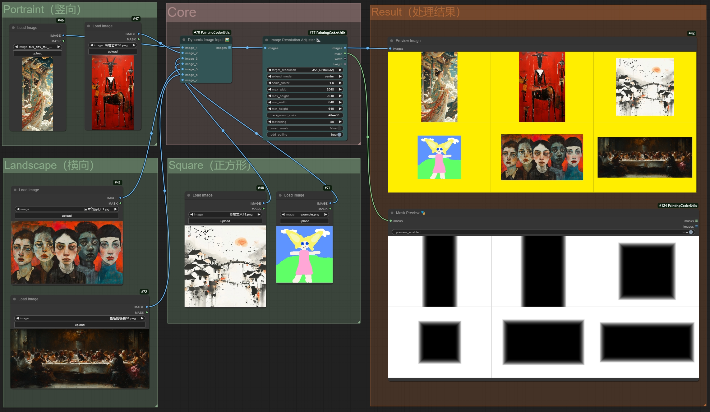

# ComfyUI Painting Coder Utilities


이미지 크기 조정, 텍스트 정리, 마스크 처리와 워크플로 복구를 위한 ComfyUI 사용자 정의 노드 모음입니다. 작업에 맞는 항목을 고른 뒤 기존 노드 설명에서 세부 설정을 확인하세요.

[English](README.md) | [简体中文](README_CN.md) | [繁體中文（臺灣）](README.zh-TW.md) | [日本語](README.ja.md) | [한국어](README.ko.md)

## 작업별 선택

| 작업 | 기존 기능 |
| --- | --- |
| 이미지 해상도 조정 | `ImageResolutionAdjuster` |
| 이미지·latent 크기 생성 | `ImageSizeCreator`, `ImageLatentCreator` 및 Plus 버전 |
| 이미지·마스크 결합과 확인 | `DynamicImageCombiner`, `DynamicMaskCombiner`, `MaskPreview` |
| 텍스트 정리·결합·표시 | `RemoveEmptyLinesAndLeadingSpaces`, `TextCombiner`, `ShowTextPlus` |
| 워크플로 값 전환 | 이미지·텍스트·마스크·latent 전환 노드 |
| URL 이미지 불러오기·인코딩 | `WebImageLoader`, `ImageToBase64` |



기존 프로젝트의 실제 워크플로 이미지이며 AI로 생성한 제품 목업이 아닙니다.

## ComfyUI 환경에 설치

ComfyUI를 실행하는 Python을 사용하세요. 호환되지 않는 Torch를 추가 설치하지 않도록 주의하세요. requirements.txt에는 NumPy, Pillow, Torch, Gradio가 선언되어 있습니다. 환경 호환성을 확인한 뒤 의존성을 설치하고, 저장소를 복제한 후 ComfyUI를 다시 시작하세요.

```sh
cd ComfyUI/custom_nodes
git clone https://github.com/jammyfu/ComfyUI_PaintingCoderUtils.git
# Run with the Python interpreter used by ComfyUI:
python -m pip install -r ComfyUI_PaintingCoderUtils/requirements.txt
```

## 기존 워크플로 이전과 첫 예제

v0.3.0의 네임스페이스 변경으로 이전 워크플로가 작동하지 않을 수 있습니다. JSON을 먼저 백업한 뒤 로컬 브라우저 복구 도구로 노드 이름과 경로 구분자를 바꾸고 ComfyUI에서 다시 여세요. 포함된 Flux 워크플로는 추가 노드와 모델 파일이 필요할 수 있으며, 모델 자체는 포함하지 않습니다.

- [Workflow fixer](docs/fix/workflow_fixer.html)
- [Flux workflow JSON](workflow/Flux_Image_Resolution_Adjuster_scale_up_batch_workflow.json)

## 범위와 사용 조건

__init__.py에 등록된 노드 클래스는 20개입니다. 5개 언어 안내는 노드 UI가 5개 언어를 지원한다는 뜻이 아닙니다. 상세한 기존 설정 자료는 영어·중국어로 보존했습니다. 이번 문서 수정이 모든 ComfyUI/PyTorch 조합의 검증을 의미하지는 않습니다.

코드는 상업적 사용·수정·재배포가 가능하며 저작권 및 라이선스 고지를 유지해야 합니다. 모델, 입력 자료와 제3자 이미지의 권리는 별도로 확인하세요.
(MIT) · [LICENSE](LICENSE)

## 상세 자료

- [English node reference](README.reference.md) · [中文节点参考](README_CN.reference.md)
- [Contributing](CONTRIBUTING.md) · [Security](SECURITY.md)
- [Issues](https://github.com/jammyfu/ComfyUI_PaintingCoderUtils/issues)
