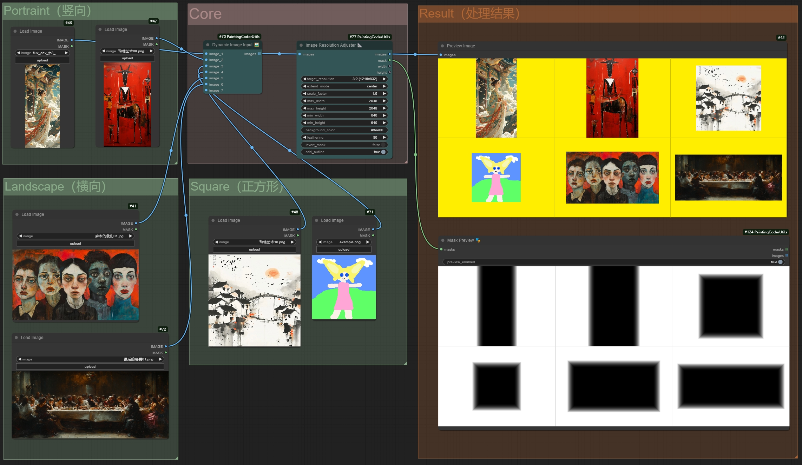

# ComfyUI Painting Coder Utilities


ComfyUI nodes for image sizing, text cleanup, masks and workflow repair. Choose a task below, then open the original node reference.

[English](README.md) | [简体中文](README_CN.md) | [繁體中文（臺灣）](README.zh-TW.md) | [日本語](README.ja.md) | [한국어](README.ko.md)

## Choose a task

| Task | Existing entry |
| --- | --- |
| Resize images without inventing a new workflow | `ImageResolutionAdjuster` |
| Create image/latent dimensions | `ImageSizeCreator`, `ImageLatentCreator` and Plus variants |
| Combine or inspect images and masks | `DynamicImageCombiner`, `DynamicMaskCombiner`, `MaskPreview` |
| Clean, join or display text | `RemoveEmptyLinesAndLeadingSpaces`, `TextCombiner`, `ShowTextPlus` |
| Route workflow values | image, text, mask and latent switch nodes |
| Load URLs or encode images | `WebImageLoader`, `ImageToBase64` |



Existing project workflow screenshot; not an AI-generated product mockup.

## Install in your ComfyUI environment

Use the Python interpreter that runs ComfyUI. Do not install a second incompatible Torch build into it. The pack declares NumPy, Pillow, Torch and Gradio dependencies in requirements.txt; review their compatibility before installing. Restart ComfyUI after cloning.

```sh
cd ComfyUI/custom_nodes
git clone https://github.com/jammyfu/ComfyUI_PaintingCoderUtils.git
# Run with the Python interpreter used by ComfyUI:
python -m pip install -r ComfyUI_PaintingCoderUtils/requirements.txt
```

## Workflow migration and first example

The v0.3.0 namespace change can break older workflows. Back up the JSON first, use the local browser fixer to update names/path separators, then reopen it in ComfyUI. The bundled Flux workflow may need other nodes and model files; this repository does not bundle them.

- [Workflow fixer](docs/fix/workflow_fixer.html)
- [Flux workflow JSON](workflow/Flux_Image_Resolution_Adjuster_scale_up_batch_workflow.json)

## Scope and permission

20 node classes are registered in __init__.py. These five guides do not imply five-language node UI. Full historical node settings remain in the English/Chinese references. This documentation change does not certify every ComfyUI/PyTorch version.

You may use, modify and distribute the code, including commercially, while retaining the copyright and license notice. Model, workflow-input and third-party image rights are separate.
(MIT) · [LICENSE](LICENSE)

## Reference

- [English node reference](README.reference.md) · [中文节点参考](README_CN.reference.md)
- [Contributing](CONTRIBUTING.md) · [Security](SECURITY.md)
- [Issues](https://github.com/jammyfu/ComfyUI_PaintingCoderUtils/issues)
