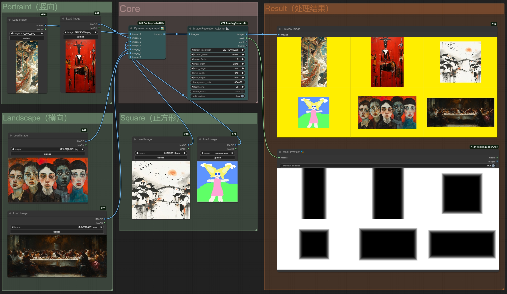

# ComfyUI Painting Coder Utilities


用於影像尺寸、文字清理、遮罩處理與工作流程修復的 ComfyUI 節點套件。先依任務選擇入口，再查看原有節點說明。

[English](README.md) | [简体中文](README_CN.md) | [繁體中文（臺灣）](README.zh-TW.md) | [日本語](README.ja.md) | [한국어](README.ko.md)

## 依任務選擇

| 任務 | 現有入口 |
| --- | --- |
| 調整影像解析度 | `ImageResolutionAdjuster` |
| 建立影像與 latent 尺寸 | `ImageSizeCreator`、`ImageLatentCreator` 與 Plus 版本 |
| 合併或預覽影像、遮罩 | `DynamicImageCombiner`、`DynamicMaskCombiner`、`MaskPreview` |
| 清理、串接或顯示文字 | `RemoveEmptyLinesAndLeadingSpaces`、`TextCombiner`、`ShowTextPlus` |
| 切換工作流程資料 | 影像、文字、遮罩與 latent 切換節點 |
| 載入網址影像或編碼 | `WebImageLoader`、`ImageToBase64` |



既有專案的工作流程截圖，並非 AI 生成的產品示意圖。

## 安裝至 ComfyUI 環境

請使用實際執行 ComfyUI 的 Python，避免另外安裝不相容的 Torch。requirements.txt 列有 NumPy、Pillow、Torch 與 Gradio，請先檢查環境相容性再安裝相依套件。完成複製後重新啟動 ComfyUI。

```sh
cd ComfyUI/custom_nodes
git clone https://github.com/jammyfu/ComfyUI_PaintingCoderUtils.git
# Run with the Python interpreter used by ComfyUI:
python -m pip install -r ComfyUI_PaintingCoderUtils/requirements.txt
```

## 移轉舊工作流程與第一個範例

v0.3.0 調整了命名空間，舊工作流程可能無法使用。請先備份 JSON，再以本機瀏覽器修復工具更新節點名稱與路徑分隔符號，最後在 ComfyUI 重新開啟。附帶的 Flux 工作流程可能需要其他節點與模型檔案，本儲存庫不包含這些模型。

- [Workflow fixer](docs/fix/workflow_fixer.html)
- [Flux workflow JSON](workflow/Flux_Image_Resolution_Adjuster_scale_up_batch_workflow.json)

## 範圍與使用條件

__init__.py 註冊了 20 個節點類別。五語導覽不代表節點介面支援五語；完整歷史參數說明仍保留於中英參考文件。這次文件更新不表示所有 ComfyUI/PyTorch 組合皆已驗證。

程式碼可用於商業用途、修改與散布，須保留著作權與授權聲明。模型、輸入素材及第三方圖片須另外確認權利。
（MIT） · [LICENSE](LICENSE)

## 詳細參考

- [English node reference](README.reference.md) · [中文节点参考](README_CN.reference.md)
- [Contributing](CONTRIBUTING.md) · [Security](SECURITY.md)
- [Issues](https://github.com/jammyfu/ComfyUI_PaintingCoderUtils/issues)
