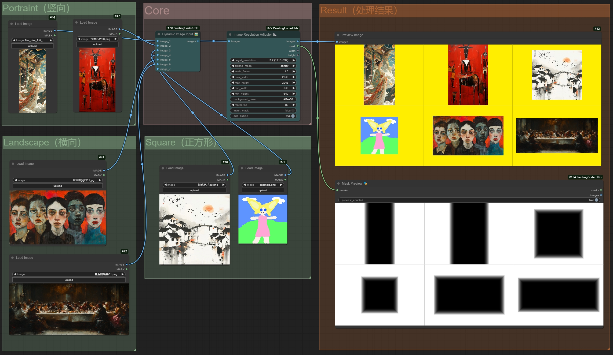

# ComfyUI Painting Coder Utilities


用于图像尺寸、文本清理、遮罩处理和工作流修复的 ComfyUI 节点包。先按任务选入口，再查看原有节点详细说明。

[English](README.md) | [简体中文](README_CN.md) | [繁體中文（臺灣）](README.zh-TW.md) | [日本語](README.ja.md) | [한국어](README.ko.md)

## 按任务选择

| 任务 | 已有入口 |
| --- | --- |
| 调整图像分辨率 | `ImageResolutionAdjuster` |
| 创建图像与 latent 尺寸 | `ImageSizeCreator`、`ImageLatentCreator` 及 Plus 版本 |
| 组合或预览图像、遮罩 | `DynamicImageCombiner`、`DynamicMaskCombiner`、`MaskPreview` |
| 清理、拼接或显示文本 | `RemoveEmptyLinesAndLeadingSpaces`、`TextCombiner`、`ShowTextPlus` |
| 切换工作流数据 | 图像、文本、遮罩及 latent 切换节点 |
| 读取网址图片或编码 | `WebImageLoader`、`ImageToBase64` |



已有项目工作流截图，不是 AI 生成的产品效果图。

## 安装到 ComfyUI 环境

使用实际运行 ComfyUI 的 Python，避免另装不兼容的 Torch。requirements.txt 声明了 NumPy、Pillow、Torch 和 Gradio，请先检查环境兼容性再安装依赖。克隆后重启 ComfyUI。

```sh
cd ComfyUI/custom_nodes
git clone https://github.com/jammyfu/ComfyUI_PaintingCoderUtils.git
# Run with the Python interpreter used by ComfyUI:
python -m pip install -r ComfyUI_PaintingCoderUtils/requirements.txt
```

## 迁移旧工作流与第一个示例

v0.3.0 调整了命名空间，旧工作流可能失效。先备份 JSON，再用本地浏览器修复工具更新节点名称和路径分隔符，最后在 ComfyUI 中重新打开。附带的 Flux 工作流可能依赖其他节点和模型文件，本仓库不包含这些模型。

- [Workflow fixer](docs/fix/workflow_fixer.html)
- [Flux workflow JSON](workflow/Flux_Image_Resolution_Adjuster_scale_up_batch_workflow.json)

## 范围与使用条件

__init__.py 注册了 20 个节点类。五语导读不表示节点界面支持五语；完整历史参数说明仍在中英参考文档。这次文档更新不等于已验证所有 ComfyUI/PyTorch 组合。

代码可商用、修改及分发，须保留版权和许可声明。模型、输入素材及第三方图片需另查权利。
（MIT） · [LICENSE](LICENSE)

## 详细参考

- [English node reference](README.reference.md) · [中文节点参考](README_CN.reference.md)
- [Contributing](CONTRIBUTING.md) · [Security](SECURITY.md)
- [Issues](https://github.com/jammyfu/ComfyUI_PaintingCoderUtils/issues)
